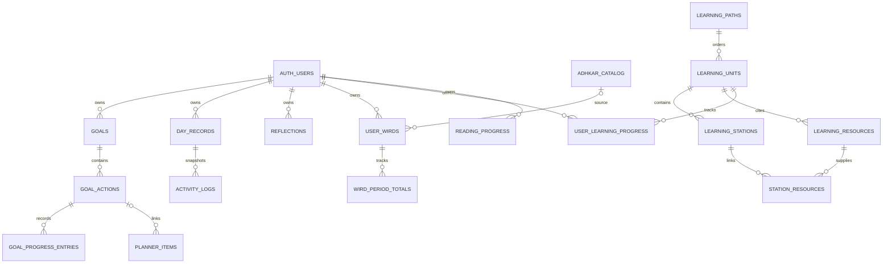

# Database schema and project review

## Current application and scope

Reviewed the product specification, application state, Supabase calls, admin editor,
planner and tracking models, goal history, wird counters, reflection UI, reader,
authentication, storage upload code, and existing migrations.

The application is React/Vite with Supabase Auth, PostgreSQL and Storage. The old
README's statement that there is no authentication/backend is out of date.
Passwords and sessions belong to `auth.users` / Supabase Auth; do not create a
second password table.

The existing `user_data` JSON document remains the source of truth for the current
frontend. `platform_curriculum` remains the shared editor document. The new
migration is an **additive relational foundation**, not a frontend migration or an
automatic backfill. Existing data is neither overwritten nor copied into a second
independently editable representation. New tables start empty. Do not switch reads
to them until a separately tested conversion and client cutover are implemented.

Cloud user-state payloads store personal `curriculumProgress`, not copies of the
shared curriculum units and resources. `saveCloudState` strips the shared catalog
before upsert; `load_my_user_state()` returns only personal progress from legacy
payloads that still contain a curriculum snapshot. Migration
`202610310005_compact_user_state.sql` is applied to the connected Supabase project.
The client retains an owner-RLS fallback for compatibility with environments where
the RPC has not yet been deployed.

## Data map

| Feature | Tables | Key decisions |
| --- | --- | --- |
| Account settings | `user_preferences` | Timezone, locale, city, work/sleep times, prayer and notification settings |
| Goals | `goals`, `goal_actions`, `goal_progress_entries` | Daily/weekly/monthly/yearly steps; completion per period |
| Planning | `planner_items` | Tasks, day slots, prayer-relative timing, optional link to goal action; `week_start` and optional `scheduled_date` for numbered weekly planning |
| Day history | `day_records`, `activity_logs` | Immutable-by-convention snapshots independent of current templates; pending/done/deferred |
| Private reviews | `reflections`, review fields on `day_records` | Owner-only; content admins cannot read other users' entries |
| Adhkar | `adhkar_catalog`, `user_wirds`, `wird_period_totals` | Approved catalog separate from personal targets; corrected totals per period |
| Curriculum | `learning_paths`, `learning_units`, `learning_stations` | Ordered units, revisions and seven station positions |
| Sources and media | `learning_resources`, `station_resources` | Source/book/video metadata, optional license note, station-specific associations |
| Learning progress | `user_learning_progress` | Revision-scoped progress; only trusted backend writes |
| Reader bookmark | `reading_progress` | One positive page number per user/book |
| Existing integration | `user_data`, `platform_curriculum` | Preserved JSON APIs for the running app |
| Administration | `admin_accounts`, `private.admin_allowlist` | Existing confirmed-email membership mechanism |
| PDFs | `storage.buckets`, `storage.objects` | Existing public `journey-books` bucket; admin uploads |
| Deployment | `private.schema_migrations` | Migration filenames, SHA-256 checksums and application timestamps |



## Integrity and access

- Text IDs preserve current seeded and generated client identifiers. Private
  primary keys begin with `user_id`, supporting owner policy lookups.
- Composite child foreign keys include `user_id`, preventing cross-account links.
  Delete/unlink planner references before deleting their referenced goal actions.
- User-owned rows cascade when the Auth account is deleted. Historical activity
  snapshots survive planner template deletion. Deleting a day deletes its logs.
- All 18 new tables enable RLS. Anonymous access is revoked. Each private table
  has owner-only policies; admins receive no exception for personal data.
- Editorial curriculum tables are admin-only until a gated backend exists.
  Published adhkar are readable by signed-in members. The schema does not implement
  separate author/reviewer/publisher roles or enforce their workflow.
- Learning progress is owner-readable but not browser-writable, preventing forged
  completion in the future relational API. No completion endpoint is supplied yet.
- Server triggers set `updated_at` on insert/update, including existing JSON tables.
  They do not provide optimistic locking; current JSON sync is last-writer-wins.
- RLS is authorization, not end-to-end encryption. Database/service operators can
  access stored reflections. A journal encryption/key-recovery design remains open.

These policies follow the [Supabase RLS guidance](https://supabase.com/docs/guides/database/postgres/row-level-security).

## Apply

> **Removed 2026-11-21.** The SQL migrations in `supabase/migrations/` and the
> custom runner (`npm run db:plan` / `npm run db:migrate`) were deleted as part of
> the local-only Android release. The Android build ships no Supabase dependency and
> never contacts the database.
>
> The hosted schema for the optional web version is now managed directly in the
> Supabase project (SQL editor / `supabase` CLI). This document remains as the
> reference description of that schema and its RLS policies. If migrations are ever
> reintroduced, restore them under `supabase/migrations/` and add a runner again —
> the previous ledger is still present in the database as `private.schema_migrations`.

Keep database credentials out of `VITE_*` variables and out of source control. A
public Supabase browser key is insufficient to change the schema.

Take a database backup before any schema change; there is no destructive automatic
down migration.

Weekly scheduling is live in the existing JSON client through optional task fields
`weekStart` (ISO Monday date) and `scheduledDate` (a date within that week). The
`202610240002_weekly_planning.sql` migration adds equivalent constrained columns and
indexes to the relational destination. Legacy tasks without a week remain visible
in an unassigned section. No JSON data conversion or hosted SQL deployment is
required for the current frontend feature.

Monthly scheduling similarly uses `monthKey` (`YYYY-MM`) and optional
`scheduledDate` in JSON. Migration `202610240003_monthly_planning.sql` adds
`month_start` (first day of the month) and extends the date constraint to allow
either a valid weekly or monthly schedule. The client supports Gregorian months,
leap years, and moving tasks between months; a nonexistent target day is cleared
for explicit reselection. Both period planners share daily reminders and completion
sync. Existing undated monthly tasks remain available for assignment.

## Verification

```powershell
npm test
npm run build
```

> **Removed 2026-11-21.** The PGlite-based schema tests (`tests/database-schema.test.mjs`
> and the other 10 DB-dependent test files) were deleted together with the migrations.
> The current suite (`npm test`) covers client-side behavior only; it does **not**
> exercise the hosted database. Any schema verification must now be done against the
> Supabase project directly.

## Findings and remaining product work

1. **Curriculum disclosure:** the existing `platform_curriculum` read policy exposes
   the whole document to signed-in users, and bundled curriculum contains drafts
   and future units. UI locking is not access control. The new editorial tables are
   restricted, but the old path remains unchanged to preserve the running app.
   Before production, replace it with published/unlocked reads, a trusted sequential
   completion endpoint, and remove protected content from browser bundles.
2. **Relational cutover:** write a validated importer for `user_data` and
   `platform_curriculum`, preserving IDs, revision semantics, empty times, timezone
   day offsets, optional fields, and legacy period keys. Compare export round-trips
   before switching client adapters atomically. Do not enable independent dual writes.
3. **Reader bookmarks:** currently stored in device-local storage rather than user
   state. The new `reading_progress` table provides a destination, not automatic sync.
4. **Content governance:** reviewer names in the existing editor are free text.
   Separate roles, immutable versions, review/audit events, seven-station publication
   validation, license checks and a publish endpoint still need implementation.
5. **Future features:** notification delivery/jobs, recurrence expansion, individual
   dhikr increment events and explicit prayer performance statuses are not currently
   implemented. Do not infer missed prayer from absent activity records. Add these
   tables with their actual feature contracts, rather than pretending the schema
   implements these workflows.
6. **Sync and privacy:** multi-device conflict resolution, application-level journal
   encryption, account deletion UI and backup/restore exercises remain separate work.
